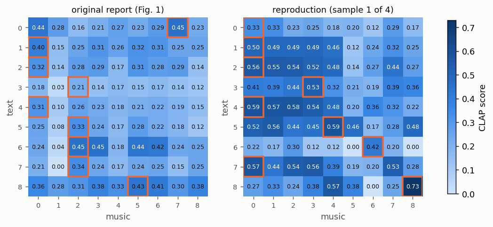
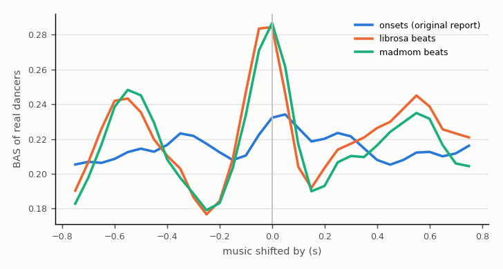
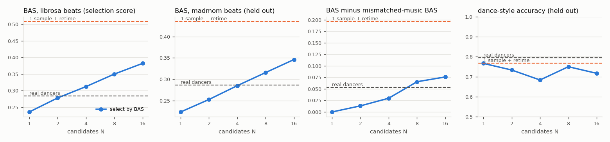
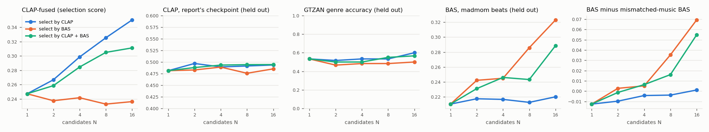
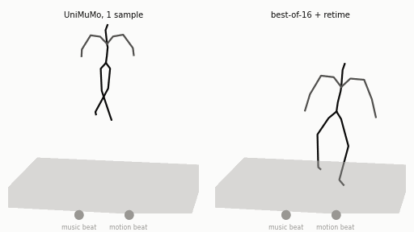
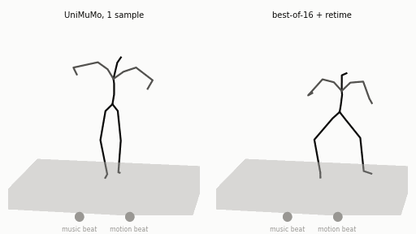

# 讓 UniMuMo 跳在拍子上：候選挑選與節拍重定時

這是 113-2 人工智慧期末專題（Team 25）的延伸。原專題用 [UniMuMo](https://github.com/hanyangclarence/UniMuMo)
從文字和音樂產生舞蹈與音樂，再用 GPT、CLAP、曲風分類器和 Beat Alignment Score（BAS）判斷結果是否符合描述，
但每個實驗只有二到十個樣本，也沒有對照組。這裡先在本機重現原本的評估流程，再把它改成有對照的實驗：
每個輸入產生 16 個候選、重複 3 個 seed，並加入真人舞者、配錯的音樂和另一個節拍偵測器當作參照。
在這個設定下可以看到，UniMuMo 舞步和音樂節拍的對齊程度，跟拿一首不相干的歌來比差不多。
我們提出兩個不需要重新訓練的方法：用 BAS（和 CLAP）從候選中挑一個，以及用動態規劃把舞步的節拍點移到音樂節拍上
（節拍重定時）。兩者都讓沒有參與挑選的同步指標明顯進步，舞風和動作品質幾乎不受影響；
用 CLAP 挑音樂則幾乎沒有反映在其他音樂評分上。

原專題成員（依報告順序）：Ke-Yang Wu、Chih-Yang Hsiao、Cai-jie Fan、Yu-Shan Lin、Kai-Yuan Cheng、Hsien-Ting Wang。
原報告與簡報在上一層資料夾：[`final_25/final_25.pdf`](../final_25/final_25.pdf)、[`AI Report.pptx`](<../AI Report.pptx>)。

## 資料夾結構

```text
beat_rerank/
├── README.md
├── requirements.txt
├── configs/                 # 生成任務清單（make_configs.py 產生）
├── scripts/
│   ├── run_generation.sh    # 重現與兩個實驗的 UniMuMo 生成
│   ├── run_eval.sh          # 評分、表格、圖和範例
│   └── check_kv_cache.py    # 確認加速後的解碼和原本的輸出完全相同
├── split_checkpoint.py      # 把 full.ckpt 拆開，16 GB 記憶體也能載入
├── unimumo_loader.py
├── fast_lm.py               # UniMuMo 解碼加上 key/value cache
├── generate_batch.py        # 每個輸入產生 N 個候選
├── beats.py                 # 音樂與動作的節拍偵測
├── metrics.py               # BAS、PFC、jerk、kinetic features、FID_k
├── retime.py                # 節拍重定時
├── judges.py                # CLAP 與 GTZAN 曲風分類器
├── motion_style.py          # 用 AIST++ 訓練的舞風分類器
├── real_reference.py        # 真人舞者的參考數值
├── score_candidates.py      # 每個候選的動作指標
├── judge_audio.py           # 每個候選的音樂指標
├── make_tables.py           # 挑選、統計檢定與結果表
├── retime_sweep.py          # 重定時強度的比較
├── reproduce_report.py      # 重現結果
├── plot_results.py
├── render_samples.py
└── results/                 # 表格、圖與範例影片
```

## 重現原專題

在本機用官方權重 `full.ckpt` 執行 UniMuMo 的三種任務（text → music + motion、text + music → motion、
text + motion → music），設定和 `generate.py` 的預設相同（guidance scale 4.0、10 秒），每個描述產生 4 個樣本。
原報告的描述只公開了一部分，其餘依同樣的寫法補齊（`configs/make_configs.py`）；text + music → motion 用 AIST 的音樂。
GPT-o3 / GPT-3 的主觀判斷需要付費 API，這裡改用兩個分類器：原報告用過的 GTZAN 曲風分類器判斷音樂，
另外訓練一個 AIST++ 舞風分類器判斷舞蹈（10 類，在沒看過的歌上正確率 93%）。完整數字見
[`results/reproduce.md`](results/reproduce.md)。

| 項目 | 原報告 | 重現 |
|---|---|---|
| CLAP 分數，9 個描述配對自己的音樂（對角線平均） | 0.269 | 0.489 ± 0.007 |
| CLAP 分數，配對其他描述的音樂（非對角線平均） | 0.245 | 0.340 ± 0.010 |
| 用 CLAP 從 9 段音樂找回自己的那段（R@1，隨機為 0.11） | 0.00 | 0.36 ± 0.09 |
| 「The music is pop genre.」被分類為 pop | 1/1 | 0/4 |
| 「The music is disco genre.」被分類為 disco | 1/1 | 4/4 |
| 9 段 text + music → motion 的 BAS | 0.262 | 0.222 ± 0.061 |
| 真人舞者的 BAS（同一個定義） | 0.22–0.27（文獻） | 0.232 ± 0.054 |



（兩邊的 9 個描述不完全相同，只能比較整體數字；橘框是每一列分數最高的音樂。）

- **CLAP**：重現的結果比原報告的圖有明顯的對角線，3 個描述中約有 1 個能從 9 段音樂裡找回自己生成的那段，
  原報告則是 0 個。原本的程式沒有留下來，無法確定差異來源；可能是 CLAP 版本不同，或音訊沒有先轉成 CLAP 要的 48 kHz。
- **曲風**：disco、classical、metal 幾乎每次都分對，pop 和各種 indie / blues-rock 描述則常被分成 rock 或 classical。
  原報告只試了 pop 和 disco 各一次，「UniMuMo 能生成指定曲風」的結論下得太早。
- **BAS**：數值和原報告接近，但原報告用的 BAS 把每個 onset 都當成拍點，onset 很密，這個分數幾乎量不到同步：
  把音樂相對真人舞者前後平移，BAS 只在 0.205–0.234 之間變動；改用 beat tracker 的拍點時，真人舞者在沒有平移時最高
  （0.28），平移半拍時降到 0.18。UniMuMo 的動作配自己的音樂和配別首歌，BAS 幾乎一樣（差 −0.003 ± 0.034）。
  所以「0.262 落在真人舞者的範圍內」並不能說明舞步有跟著拍子。



- **舞風**：text + music → motion 的 9 個描述，36 個樣本中有 32 個被分類器判成指定的舞風。
  簡報中人工判斷 lock、waack「差有點多」，分類器卻多半判對；分類器看的是動作的統計特徵，不是動作做得好不好。

## 方法

### 1. 讓 UniMuMo 生成變快

UniMuMo 生成時每一步都把已經生成的整段音樂與動作 token 重新送進 transformer，10 秒要 503 步，計算量隨長度平方成長。
它的 attention mask 在時間上是因果的（第 t 步的音樂和動作 token 只看得到 t 以前兩條序列的 token），
所以可以加上 key/value cache，每一步只算新的兩個 token。`fast_lm.py` 直接沿用 UniMuMo 的 embedding、
cross-attention、音樂與動作各自的 feed-forward 和輸出層，只改寫 self-attention。和原本的 forward 相比 logits 誤差在
3e-5 以內，同一個 seed 生成的 8 段 10 秒音樂與動作和原版逐位元相同（`scripts/check_kv_cache.py`）。
在 RTX 4060 Ti 上，8 個 10 秒樣本從 448 秒降到 18 秒，本專題約 2,000 個樣本因此只花約 1 GPU 小時。

### 2. 評估方式

- **BAS**：Bailando 的定義，對每個音樂拍點找最近的動作拍點，σ = 3 幀（60 fps）；動作拍點是平滑後關節速度的局部最小值。
  音樂拍點有三種：librosa onset（原報告的定義）、librosa beat tracker（挑選和重定時用），以及 madmom 的 RNN + DBN
  beat tracker。madmom 不參與任何挑選或重定時，用來檢查進步是否只是對某一個偵測器過度擬合。
- **ΔBAS**：配自己音樂的 BAS 減去配其他 19 段音樂的平均 BAS。跟拍子無關的動作約為 0，真人舞者約 +0.05。
- **舞風正確率**：AIST++ 舞風分類器判成描述中舞風的比例。
- **PFC**（EDGE 的腳步接觸分數，越低越好）、**FID_k** 與 **Dist_k**（AIST++ 的 kinetic features，和 130 段真人舞蹈比較）。
- **CLAP**：表中的 CLAP 是原報告用的 LAION-CLAP（`laion/clap-htsat-unfused`）；挑選時用另一個 checkpoint
  （`laion/clap-htsat-fused`，表中寫 CLAP-fused），所以表中的 CLAP 沒有參與挑選。**曲風正確率**用原報告的 GTZAN 分類器，
  也沒有參與挑選。
- 每個設定跑 3 個 seed，表中是 3 個 seed 的平均 ± 標準差。顯著性用 Wilcoxon signed-rank test，
  先把同一個輸入的 3 個 seed 平均，n = 20。

### 3. 16 選 1

每個輸入一次生成 16 個候選，再用不需要人工的分數挑一個：

- text + music → motion：挑 BAS（librosa beat）最高的。
- text → music + motion：CLAP-fused（描述和生成的音樂）與 BAS（生成的音樂和生成的動作）在 16 個候選內各自標準化後相加。

### 4. 節拍重定時

`retime.py` 先找出動作拍點和音樂拍點，用動態規劃挑一組單調的對應（每對加 1 分，播放速度的變化 |log rate| 扣分），
限制相鄰對應點之間的播放速度在 0.8–1.25 倍、時間位移不超過 0.5 秒；再用單調三次插值（PCHIP）連成時間對應，
以三次樣條重新取樣關節位置。對照組把同一段動作對到另一首歌的拍點上，用來確認進步來自對上這首歌，而不是重新取樣本身。

## 結果

### 實驗 A：text + music → motion

輸入是 20 段 AIST 音樂（10 種舞風各 2 首，取第 8–18 秒），描述用 UniMuMo 自己的模板
「The style of the dance is {舞風}.」，每段 16 個候選 × 3 個 seed。「1 個樣本」固定取第 1 個候選，等同直接跑一次 UniMuMo。
AIST 的 60 首歌都在 UniMuMo 的訓練資料裡，所以這是模型熟悉的音樂。

| 方法 | BAS<br>librosa（挑選用） | BAS<br>onset（原報告） | BAS<br>madmom | ΔBAS<br>madmom | 舞風<br>正確率 | PFC ↓ | FID_k ↓ | Dist_k |
|---|---|---|---|---|---|---|---|---|
| UniMuMo 原始輸出（1 個樣本） | 0.236 ± 0.006 | 0.223 ± 0.012 | 0.224 ± 0.003 | 0.000 ± 0.010 | 0.767 ± 0.125 | 2.13 ± 0.46 | 29.7 | 12.6 ± 1.5 |
| ＋節拍重定時 | 0.508 ± 0.011 | 0.272 ± 0.003 | 0.435 ± 0.010 | 0.197 ± 0.006 | 0.767 ± 0.125 | 2.15 ± 0.52 | 30.8 | 12.5 ± 1.5 |
| ＋重定時到另一首歌的節拍（對照） | 0.216 ± 0.010 | 0.220 ± 0.006 | 0.227 ± 0.011 | -0.018 ± 0.004 | 0.750 ± 0.147 | 2.24 ± 0.66 | 31.2 | 12.3 ± 1.6 |
| 16 選 1（依 BAS） | 0.382 ± 0.006 | 0.271 ± 0.012 | 0.346 ± 0.005 | 0.076 ± 0.011 | 0.717 ± 0.062 | 1.86 ± 0.41 | 31.5 | 12.3 ± 0.5 |
| 16 選 1（依 BAS）＋節拍重定時 | 0.546 ± 0.011 | 0.302 ± 0.010 | 0.476 ± 0.006 | 0.208 ± 0.005 | 0.700 ± 0.082 | 1.79 ± 0.47 | 30.6 | 12.0 ± 0.5 |
| 真人舞者（AIST++） | 0.284 | 0.232 | 0.287 | 0.054 | 0.795 | 1.68 | – | 10.4 |



- UniMuMo 原始輸出的 ΔBAS 是 0.000 ± 0.010：舞步跟這首歌拍子的對齊程度，和跟一首不相干的歌一樣；真人舞者是 +0.054。
- 節拍重定時把 madmom BAS 從 0.224 提高到 0.435，20 個輸入全部進步（p = 2 × 10⁻⁶）；
  舞風正確率不變，PFC、FID_k、Dist_k 也幾乎不變。把動作重定時到另一首歌的拍子（對照）則完全沒有進步，
  表示進步來自對上這首歌，而不是重新取樣讓動作變平滑（jerk 下降在兩者都有）。
- 16 選 1 讓 madmom BAS 提高 0.122（p = 4 × 10⁻⁶），是挑選用分數本身進步量（0.146）的 84%，
  所以挑選不是只在拉高某一個節拍偵測器的分數；ΔBAS 0.076 已超過真人舞者。舞風正確率 0.77 → 0.72，差異不顯著（p = 0.75）。
- 候選越多越好（上圖），16 個還沒有飽和。兩種方法合用時 madmom BAS 最高（0.476）。

重定時的強度可以用最大播放速度倍率調整（單一樣本，`results/exp_a_retime_strength.csv`）：

| 最大速度倍率 | 不重定時 | 1.05 | 1.1 | 1.15 | 1.25（上表） | 1.4 |
|---|---|---|---|---|---|---|
| BAS madmom | 0.224 | 0.302 | 0.372 | 0.411 | 0.435 | 0.446 |
| ΔBAS madmom | 0.000 | 0.063 | 0.137 | 0.173 | 0.197 | 0.217 |
| PFC ↓ | 2.13 | 2.08 | 2.26 | 2.15 | 2.15 | 2.02 |
| 舞風正確率 | 0.767 | 0.767 | 0.767 | 0.767 | 0.767 | 0.767 |

只允許 ±5% 的速度變化，同步程度就和真人舞者差不多（0.302 / 0.063 對 0.287 / 0.054）；
預設的 1.25 倍會讓動作比真人更「卡拍」，要更自然可以調小。

### 實驗 B：text → music + motion

20 個描述（GTZAN 的 10 種曲風 × 2 種寫法，例如「The music is disco genre.」和「The audio is a disco track.」，
各配一種舞風），每個描述 16 個候選 × 3 個 seed。

| 方法 | CLAP-fused<br>（挑選用） | CLAP<br>（原報告） | 曲風<br>正確率 | BAS<br>librosa（挑選用） | BAS<br>madmom | ΔBAS<br>madmom | 舞風<br>正確率 | PFC ↓ |
|---|---|---|---|---|---|---|---|---|
| UniMuMo 原始輸出（1 個樣本） | 0.247 ± 0.006 | 0.481 ± 0.003 | 0.533 ± 0.062 | 0.226 ± 0.013 | 0.210 ± 0.007 | -0.013 ± 0.005 | 0.650 ± 0.071 | 1.90 ± 0.65 |
| 16 選 1（依 CLAP） | 0.350 ± 0.010 | 0.494 ± 0.003 | 0.600 ± 0.041 | 0.225 ± 0.011 | 0.220 ± 0.020 | 0.001 ± 0.022 | 0.683 ± 0.062 | 2.03 ± 0.64 |
| 16 選 1（依 BAS） | 0.236 ± 0.008 | 0.485 ± 0.017 | 0.500 ± 0.041 | 0.388 ± 0.006 | 0.323 ± 0.012 | 0.069 ± 0.019 | 0.750 ± 0.041 | 1.84 ± 0.52 |
| 16 選 1（依 CLAP + BAS） | 0.311 ± 0.018 | 0.495 ± 0.008 | 0.567 ± 0.085 | 0.338 ± 0.007 | 0.289 ± 0.006 | 0.055 ± 0.015 | 0.683 ± 0.062 | 1.91 ± 0.29 |
| 16 選 1（依 CLAP + BAS）＋節拍重定時 | 0.311 ± 0.018 | 0.495 ± 0.008 | 0.567 ± 0.085 | 0.482 ± 0.014 | 0.367 ± 0.016 | 0.142 ± 0.023 | 0.667 ± 0.047 | 1.83 ± 0.28 |



- 一起生成的音樂和舞蹈之間也沒有對上拍：UniMuMo 原始輸出的 ΔBAS 是 −0.013 ± 0.005。依 BAS 16 選 1 後
  madmom BAS 提高 0.112（p = 2 × 10⁻⁶）；CLAP + BAS 挑選再加上重定時，ΔBAS 到 0.142，和實驗 A 一致。
- 依 CLAP 挑選對沒參與挑選的音樂評分幫助很小：挑選用的 CLAP-fused 從 0.247 升到 0.350，原報告的 CLAP 只多 0.012
  （p = 0.10），曲風正確率 0.53 → 0.60（p = 0.10），都不顯著。挑選分數的進步反映到沒參與挑選的評分上的比例，
  節拍約 70%（0.112 / 0.162），CLAP 只有約 12%（0.012 / 0.103）：兩個 CLAP checkpoint 的判斷不太一致，
  用一個 CLAP 挑出來的音樂不一定更像指定的曲風。
- CLAP 和 BAS 一起挑時，同步明顯進步（madmom BAS +0.078，p = 4 × 10⁻⁴），音樂評分方向一致但不顯著。

### 範例

範例事先固定為實驗 A 的 house、lock 兩首歌，以及實驗 B 的 disco、hip-hop 兩個描述（都取 seed 0），沒有另外挑過。
左邊（或第一個檔案）是 UniMuMo 的 1 個樣本，右邊是 16 選 1 再加節拍重定時；下方的點在音樂拍點（橘）和動作拍點（藍）時亮起。

實驗 A 用的是 AIST 的音樂，不重新散布，所以是無聲的 GIF：




實驗 B 的音樂由 UniMuMo 生成，影片有聲音（同一個資料夾也有 MP3）：

- disco：[1 個樣本](results/samples/text2musicdance_disco_0_unimumo_1sample.mp4)、
  [16 選 1 + 重定時](results/samples/text2musicdance_disco_0_bestof16_retime.mp4)
- hip-hop：[1 個樣本](results/samples/text2musicdance_hiphop_0_unimumo_1sample.mp4)、
  [16 選 1 + 重定時](results/samples/text2musicdance_hiphop_0_bestof16_retime.mp4)

全部實驗在一張 RTX 4060 Ti 16 GB 上完成：生成約 1 GPU 小時，評分在 CPU 上約 30 分鐘。

## 執行方式

環境（Python 3.9、CUDA 11.6 版的 PyTorch 1.13.1，在 RTX 4060 Ti 16 GB 上執行）：

```bash
conda create -n unimumo -c conda-forge python=3.9 pip ffmpeg=6
conda activate unimumo
pip install torch==1.13.1+cu116 torchaudio==0.13.1+cu116 --extra-index-url https://download.pytorch.org/whl/cu116
pip install -r requirements.txt   # madmom 若安裝失敗，先裝好其他套件再 pip install --no-build-isolation madmom==0.16.1
```

模型與資料（都不放進 git）：

```bash
git clone https://github.com/hanyangclarence/UniMuMo.git
mkdir -p pretrained data
# 把 UniMuMo 權重 full.ckpt（4.7 GB）下載到 pretrained/：https://huggingface.co/ClarenceY/unimumo
python split_checkpoint.py --ckpt pretrained/full.ckpt --out pretrained/split
# AIST Dance DB 的音樂（mp3.zip，95 MB）：https://aistdancedb.ongaaccel.jp/database_download/ ，解壓到 data/aist_music/
# UniMuMo 整理好的動作資料 motion_data.tar.gz（4.4 GB），只需要 AIST++ 的部分（檔名 g 開頭），
# 放到 data/aist_motion/train/joint_vecs/ 和 data/aist_motion/val/joint_vecs/
```

生成與評估：

```bash
python configs/make_configs.py      # 產生 configs/*.json
python scripts/check_kv_cache.py    # （可選）確認加速版解碼和原版輸出相同
bash scripts/run_generation.sh      # 約 1 GPU 小時
bash scripts/run_eval.sh            # 結果寫到 results/
```

單獨使用節拍重定時：

```python
from retime import retime
from beats import load_audio, music_beats_librosa

beats = music_beats_librosa(load_audio("song.mp3"), mode="beat", n_frames=len(joints))
new_joints, info = retime(joints, beats)  # joints: (T, 22, 3)，60 fps
```

## 參考資料

- H. Yang et al., "UniMuMo: Unified Text, Music, and Motion Generation," AAAI 2025.
- S. Li et al., "Bailando: 3D Dance Generation by Actor-Critic GPT with Choreographic Memory," CVPR 2022.（BAS 的定義）
- J. Tseng, R. Castellon, C. K. Liu, "EDGE: Editable Dance Generation From Music," CVPR 2023.（PFC）
- R. Li et al., "AI Choreographer: Music Conditioned 3D Dance Generation with AIST++," ICCV 2021.（AIST++、kinetic features、FID_k）
- S. Tsuchida et al., "AIST Dance Video Database," ISMIR 2019.
- Y. Wu et al., "Large-scale Contrastive Language-Audio Pretraining with Feature Fusion and Keyword-to-Caption Augmentation," ICASSP 2023.（CLAP）
- S. Böck et al., "madmom: a new Python Audio and Music Signal Processing Library," ACM MM 2016.
- B. McFee et al., "librosa: Audio and Music Signal Analysis in Python," SciPy 2015.
- A. Davis, M. Agrawala, "Visual Rhythm and Beat," SIGGRAPH 2018.（依節拍調整舞蹈影片的時間）
- J. Copet et al., "Simple and Controllable Music Generation," NeurIPS 2023.（MusicGen，UniMuMo 的基礎模型）
- GTZAN 曲風分類器：[dima806/music_genres_classification](https://huggingface.co/dima806/music_genres_classification)
